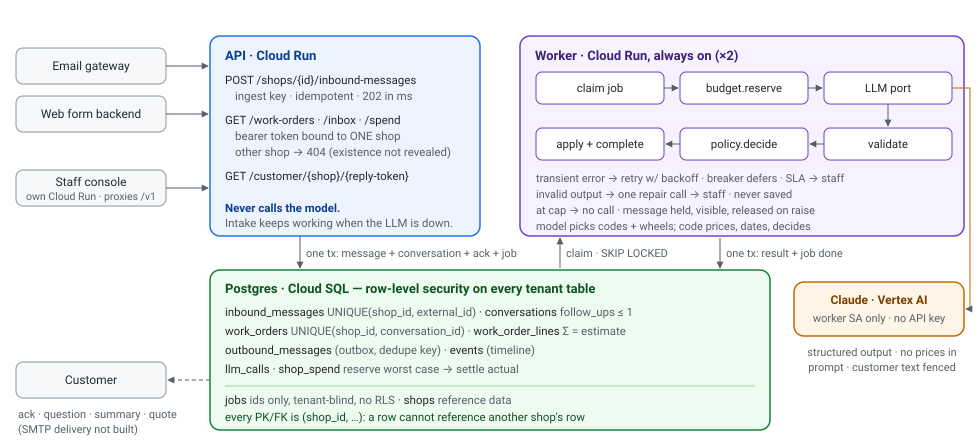
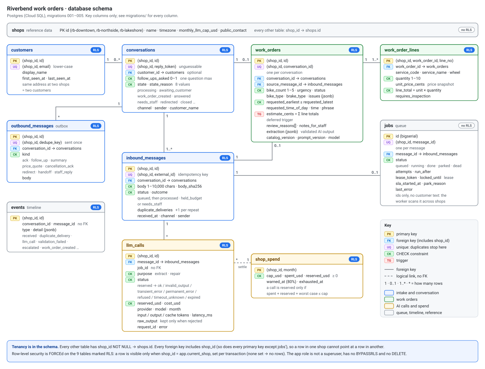

# Riverbend work orders: architecture note

**One message, end to end.** Intake stores the message, its conversation, the customer's acknowledgement and a job in **one transaction**, then returns `202` in milliseconds. A worker claims the job, reserves budget, calls Claude **outside any transaction**, validates the output, lets `policy` decide, and commits the result together with the job's completion in **one transaction**. Delivery is at-least-once; every write is idempotent.

## Module boundaries

| Module | Owns | Must not |
|---|---|---|
| `api`, `intake`, `staff_auth` | auth and staff sign-in, HTTP validation, idempotent accept | call the model; touch a second tenant; store a password or token |
| `ui/` (separate app) | the staff console: read views + staff actions, via its own `/v1` proxy | hold secrets; compute prices or dates |
| `jobqueue`, `worker` | claim (fair across shops; SKIP LOCKED + lease), retry, park, dead-letter; 1–3 worker threads by backlog | know any business rule |
| `pipeline` | orchestrating one message | price, compute dates or make policy itself |
| `llm/` port + adapters | provider calls, error classification, breaker, fault injection | leak SDK types; retry (SDK retries are **off**) |
| `extraction/` | the model contract: schema, prompt, validation, date resolution | see a price or the database |
| `policy` | **pure** decision: work order / ask / quote / cancel / redirect / escalate | do I/O |
| `catalog` | prices, units, money in integer cents | be bypassed: it is the only path to a price |
| `budget` | per-shop-month reserve → settle → sweep | — |
| `customer_copy` | every sentence a customer receives | contain model-written prices, dates or promises |

What crosses each line is narrow: the pipeline hands the port an `LLMRequest` and gets text back. Only a validated `Extraction` reaches `policy`. Only a `Decision` reaches the writer. The model's text never becomes a price, a date, a SQL value it chose, or a customer promise.

## Data model

`customers` (one per email address per shop, `UNIQUE(shop_id, email)`) → `conversations` (state, `follow_ups_asked CHECK ≤ 1`, unguessable `reply_token`) → `inbound_messages` (`UNIQUE(shop_id, external_id)` is the idempotency key) → `work_orders` (`UNIQUE(shop_id, conversation_id)`, requested window, urgency, review flags, the validated extraction for audit, `catalog_version`, `prompt_version`, `model`) → `work_order_lines` (unit price snapshot, `CHECK line_total = unit × qty`; a deferred trigger rejects any order whose estimate ≠ Σ lines). `outbound_messages` is the customer outbox (dedupe key per send). `llm_calls` is one row per call, failures included, with tokens, cost and the raw output when it was rejected. `shop_spend` holds cap, spent and reserved per shop-month. `events` is the timeline. `jobs` holds ids only. `staff_accounts` and `staff_sessions` hold sign-in (password hashes and token hashes only); they're the only tables besides `shops` and `jobs` without a `shop_id`, because sign-in finds the account before it knows the shop.

## Tenancy isolation: three layers, each sufficient alone

1. **Data model.** Every tenant table has `shop_id NOT NULL`. Every primary key is `(shop_id, id)` and every foreign key is composite, so a Lakeshore line item *cannot* point at a Downtown order, even when written by a superuser.
2. **Database.** Row-level security is `FORCE`d on all nine tenant tables. Each request or job opens a `tenant_tx(shop)` that sets `app.current_shop` **transaction-locally**, so the setting cannot leak through the connection pool. With no tenant set, every policy matches zero rows: it fails closed. The runtime role has no superuser, no `BYPASSRLS` and no `DELETE`.
3. **Edge.** Staff sign in with email and password and get a personal session that opens only the shops on their account (a shop's static token opens just that shop). Asking about another shop returns `404`, so the API doesn't even confirm the other shop's data exists. The queue is tenant-blind but holds only ids. The model sees one conversation. A message addressed to another shop is **never moved across tenants**: the customer is asked and pointed to that shop.

`tests/test_tenancy.py` attacks these layers as the real runtime role: a missing WHERE clause, a missing tenant, a wrong-tenant INSERT and UPDATE, pool reuse, and cross-tenant API calls.

## How it fails (measured in [RESULTS.md](RESULTS.md))

| Event | Customer sees | Shop sees | Mechanism |
|---|---|---|---|
| Same message twice | one ack, `200` on the repeat | one order | unique keys at intake, queue and write |
| Provider slow / down | instant ack; "a team member is reviewing" after the SLA | inbox `needs_staff: ai_unavailable` + **Retry AI**; alert | backoff + jitter, circuit breaker, SLA hand-off |
| Bad model output | nothing | never saved; one repair call, then staff | strict schema, grounding check, domain rules |
| Monthly cap reached | ack | message `held_budget` with full text; alert | worst-case reservation, conditional `UPDATE` |
| Prompt injection (m-1024) | correct $45.00 quote | flagged order; urgency capped | no money fields exist; code pattern check |

## The three decisions I would most want challenged

**1. Postgres is the queue.** Accepting a message and enqueuing its job is one transaction, so there is no dual-write gap. Dedupe is a constraint, not a cache. There is one stateful thing to operate and back up. *Cost:* polling workers must stay always on (the largest fixed cost on GCP, about $50–100/month), throughput tops out far below Pub/Sub's, and there is no fan-out. At Riverbend's volume (hundreds of messages a day) none of that binds. *I'd switch* to Pub/Sub or Cloud Tasks, with this table kept as the source of truth, beyond roughly 50 messages per second or when a second consumer appears.

**2. One shared schema with RLS, not a database per shop.** Three shops share one catalog and one team. RLS plus composite keys makes the database, not code review, the thing that enforces isolation. *Cost:* a mistake in a policy is a mistake for every tenant. That is why tenancy has the most tests and why all of them run as the runtime role. Noisy neighbours share one Postgres and one FIFO queue, and per-tenant restore or export is harder. Superusers bypass RLS, so operators must use the app role too. *I'd revisit* when a tenant needs its own residency, encryption keys or restore point.

**3. The model describes; code decides.** The prompt contains no prices. The model returns service codes and wheels, *never* numbers that become money. It classifies the timing phrase ("next Tuesday" → `next_weekday/tuesday`) and code resolves the calendar date. Every service and issue must quote the customer **verbatim**, or validation rejects it. Code, not the model, decides whether a follow-up question is justified, and caps urgency under suspected injection. *Cost:* a legitimate paraphrase gets rejected and costs a repair call, and the schema is larger. Phrases outside the date taxonomy fall back to "unspecified", which leads to a follow-up question. *I'd loosen* grounding to fuzzy matching only if live evals showed real recall loss.
